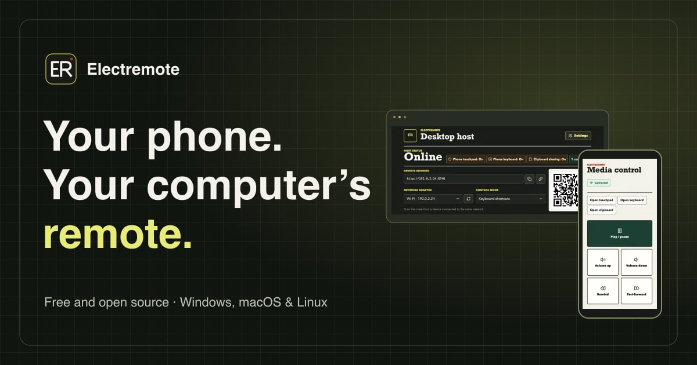

# Electremote — Your phone is your computer’s remote

**Use your iPhone or Android as a Wi-Fi remote for your Windows PC, Mac, or Linux computer.** Play and pause, adjust the volume, move the mouse, type, or send text between devices. It’s free and open source, with no account or phone app to install.

**[Download the latest release](https://github.com/antoniormrzz/electron-remote-control/releases/latest)** · [See the remote in action](https://electremote.netlify.app/)

## It started with an HDMI cable

Back in 2020, movie night meant plugging a laptop into the TV, getting comfortable, and immediately having to get back up because the volume was wrong. Electremote started with a simple idea for lazy HDMI users: the laptop stays by the TV. You stay on the couch.

It’s still that remote, just with a few more tricks.

## What you can do with it

- **Run movie night from your phone.** Give an old PC a second life as a media hub. Hook it up to the TV, open VLC or a browser, and pause, rewind, fast-forward, or turn the volume down without getting up.
- **Keep podcasts on a second computer.** Let a spare laptop handle the listening while you work. Pause before a call or change the volume without leaving the app you’re working in.
- **Use your phone as a mouse and keyboard.** Turn on the touchpad to move, scroll, and click. Enable the keyboard to type into the active app or send a shortcut. Handy when the laptop is on the other end of the HDMI cable.
- **Pass a link or note between screens.** Turn on clipboard sharing and choose when to send or retrieve text. Nothing syncs automatically.

## Download and connect

1. **Get Electremote for the computer you want to control.** The [latest GitHub release](https://github.com/antoniormrzz/electron-remote-control/releases/latest) has a ZIP for Windows, DMGs for Apple Silicon and Intel Macs, and DEB and RPM packages for Linux.
2. **Open the desktop app and scan its QR code.** Your phone and computer need to be on the same local network.
3. **Open the link in your phone’s browser.** Bookmark it for next time. For a computer you use as a media hub, you can turn on **Start at login** in Settings.

Electremote doesn’t need internet access once you’ve downloaded the desktop app. Whatever you’re playing may still need it. You can use keyboard shortcuts for the active player or switch to system media keys, which your operating system routes to the player it controls.

Free and open source under the [MIT license](LICENSE).
